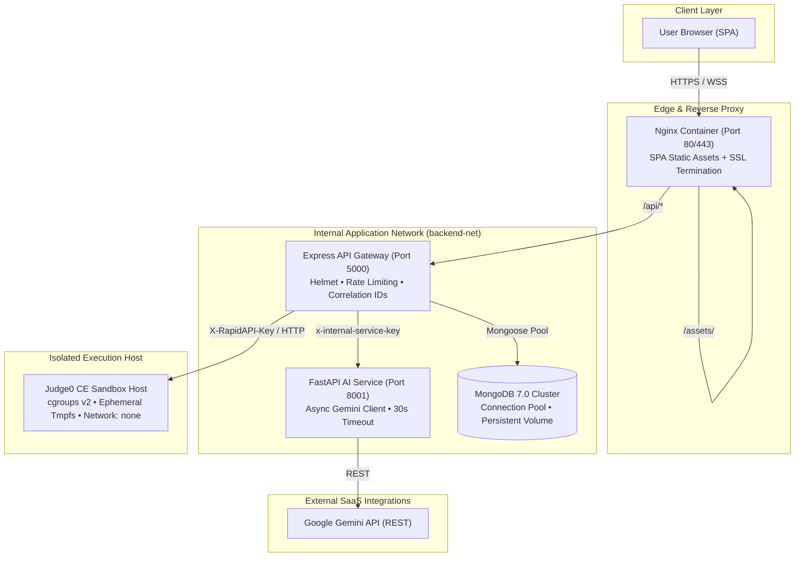

# InterviewPrep — Production Deployment & Operations Guide

## 1. System Architecture Overview



---

## 2. Infrastructure Requirements

### Minimum Production Specifications
- **Host Operating System:** Ubuntu 22.04 LTS or 24.04 LTS (x86_64).
- **CPU:** 4 vCPUs minimum (8 vCPUs recommended if self-hosting Judge0).
- **RAM:** 8 GB minimum (16 GB recommended).
- **Storage:** 80 GB SSD with automatic snapshot backups.
- **Docker Engine:** Version 26.0+ with Docker Compose v2.

---

## 3. Step-by-Step Deployment Guide

### Step 1: Clone Repository & Configure Environment
```bash
git clone https://github.com/harsh8957/InterviewPrep.git /opt/interviewprep
cd /opt/interviewprep
```

### Step 2: Set Up Production Environment Secrets
Copy the production template:
```bash
cp .env.production.example .env.production
```
Generate secure keys:
```bash
# Generate 32-byte JWT secret
openssl rand -base64 32

# Generate internal service authentication key
openssl rand -hex 24
```
Edit `.env.production` and fill in:
- `JWT_SECRET`
- `INTERNAL_SERVICE_KEY`
- `GEMINI_API_KEY`
- `RAPIDAPI_KEY` (if using hosted Judge0 CE)
- `FRONTEND_URL` (your custom production domain)

### Step 3: Launch with Docker Compose
```bash
# Build and start all services in detached mode
docker compose -f docker-compose.yml -f docker-compose.prod.yml up -d --build
```

### Step 4: Verify Subsystem Health
Execute the automated health check:
```bash
curl -i http://localhost:8080/api/health
```
Expected response:
```json
{
  "status": "healthy",
  "uptimeSeconds": 12,
  "subsystems": {
    "database": { "status": "up" },
    "evaluator": { "status": "up" },
    "judge": { "status": "up" }
  }
}
```

### Step 5: Seed Curriculum & Technical Tracks
Initialize database with curated DSA patterns, Core CS quizzes, and top company tracks:
```bash
docker compose exec backend npm run seed:dsa
docker compose exec backend npm run seed:core-cs
docker compose exec backend npm run seed:companies
```

### Step 6: Provision Administrator Account
Create the platform root administrator account:
```bash
docker compose exec -it backend npm run create-admin
```

---

## 4. Monitoring, Health Checks & Log Rotation

### Health Probes
- **Frontend / Ingress:** `GET /healthz`
- **Backend API Gateway:** `GET /api/health`
- **Evaluator AI Service:** `GET /ready` and `GET /health`

### Container Logging Policies
All containers configured with JSON file rotation (`max-size: 10m`, `max-file: 3`) to prevent disk exhaustion.
View live logs:
```bash
docker compose logs -f --tail=100 backend
docker compose logs -f --tail=100 evaluator
```

---

## 5. Security & Isolation Controls

1. **Internal Network Boundary (`backend-net`):** MongoDB and the FastAPI evaluator run strictly on an internal bridge network with no mapped ports to the host machine or public internet.
2. **Reverse Proxy & Ingress:** Only Nginx binds to ports 80 and 443. All client requests to `/api/*` are reverse-proxied internally.
3. **Correlation ID Tracking:** Every API interaction propagates an `X-Correlation-ID` header from entry to upstream services for unified tracing.
4. **Rate Limiting:** Protects authentication (30 attempts/15min), AI operations (40/15min), and code execution (60/15min).
