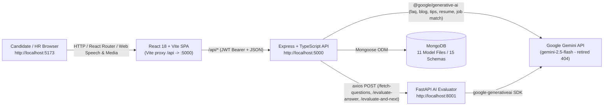

# Current Architecture

**Audit Date:** 2026-11-12  
**Status:** Verified from source inspection, build execution, and local multi-service execution against an isolated MongoDB database (`interviewprep_audit_test`).

---

## 1. Verified Technology Stack

| Layer | Technologies Used in Code | Declared but Unused Dependencies |
| :--- | :--- | :--- |
| **Frontend** | React `^18.3.1`, TypeScript `^5.5.3`, Vite `^5.4.2`, React Router DOM `^6.22.3`, Tailwind CSS `^3.4.17`, Lucide React `^0.344.0`, `date-fns ^3.3.1`, `clsx`, `tailwind-merge`, Web Speech API (`SpeechRecognition` / `SpeechSynthesis`), `MediaDevices.getUserMedia` | `socket.io-client`, `formik`, `yup`, `react-datepicker`, `@google-cloud/speech`, `@google-cloud/text-to-speech`, `dotenv`, `classnames` |
| **Backend** | Node.js `v22.13.1`, Express `^4.18.2`, TypeScript `^5.5.3`, `tsx`, `tsup`, Mongoose `^8.14.3`, MongoDB driver `^6.16.0`, `jsonwebtoken ^9.0.2`, `bcryptjs ^2.4.3`, `axios ^1.9.0`, `cors`, `@google/generative-ai ^0.24.1` (`aiService.ts`) | `socket.io`, `multer`, `nodemailer`, `uuid`, `clsx`, `tailwind-merge` (Wait: `uuid` is imported in `interviews.ts` for room links; `socket.io`, `multer`, `nodemailer` returned zero source matches via `git grep`) |
| **AI Evaluator** | Python `3.12.6`, FastAPI `0.141.1`, Uvicorn `0.52.3`, Pydantic `2.13.4`, `google-generativeai 0.8.6` (deprecated SDK), `python-dotenv 1.2.2`, `requests 2.34.2` | `spacy 3.8.15` (listed in `requirements.txt`, not imported in `main.py`) |
| **Database** | MongoDB `8.2` via Mongoose schemas (`11` model files defining `15` schemas) | — |

---

## 2. System Topology & Data Flow

---

## 3. Component Responsibilities

### 3.1 Frontend (`frontend/src/`)
- **Entry & Routing (`App.tsx`):** Wraps routes inside `AuthProvider` -> `HRProvider` -> `InterviewProvider` -> `<Layout />`. Route protection is enforced only on client state (`user` / `user?.role`) for `/setup`, `/interview`, `/results`, `/results/:id`, `/hr/dashboard`, `/candidate/dashboard`, `/interview-room/:id`.
- **State Contexts (`frontend/src/contexts/`):**
  - `AuthContext.tsx`: Stores JWT in `localStorage` (`token`), hydrates user via `GET /api/auth/me` on mount, exposes `login`, `signup`, `logout`.
  - `InterviewContext.tsx`: Manages active interview configuration, question list, local audio/video `MediaRecorder` state, Web Speech transcription hooks, `POST /api/interviews/gemini/questions`, `POST /api/interviews/gemini/evaluate-and-next`, fallback scoring (`Math.floor(Math.random() * 21) + 50`), and `POST /api/interview-results`.
  - `HRContext.tsx` & `ThemeContext.tsx`: Manage HR client state and `light`/`dark`/`system` root theme class.
- **Proxying (`frontend/vite.config.ts`):** Proxies `/api/*` to `http://localhost:5000` in dev; `frontend/vercel.json` rewrites non-API paths to `/index.html` for SPA deployment.

### 3.2 Backend (`backend/src/`)
- **Server (`index.ts`):** Connects MongoDB (`lib/db.ts`), configures CORS for `process.env.FRONTEND_URL || 'http://localhost:5173'`, parses JSON (`express.json()`), mounts **12 route modules** under `/api/*`, and uses a catch-all 500 error middleware.
- **Auth Middleware (`server/middleware/auth.ts`):** `authenticateToken` verifies Bearer JWT; `requireHR` permits `['hr', 'admin']`; `requireAdmin` permits `'admin'`.
- **Direct AI Service (`services/aiService.ts`):** Wraps `@google/generative-ai` (`gemini-2.5-flash`) for secondary features (FAQ AI, Blog summarize, Resume analyze/improve, Interview Tips coach, Job application match scoring). Reads `process.env.GEMINI_API_KEY` inside the Express process directly instead of delegating to `evaluator_service`.

### 3.3 AI Evaluator Microservice (`evaluator_service/main.py`)
- Exposes 4 endpoints: `GET /health`, `POST /fetch-questions`, `POST /evaluate-answer`, `POST /evaluate-and-next`.
- Uses regex/line-based text parsing over raw Gemini text responses (no structured JSON schema enforcement via Gemini `response_mime_type="application/json"`).
- CORS middleware allows `["http://localhost:5173", "http://localhost:5000", "*"]` with `allow_credentials=True`.

---

## 4. Key Architectural Observations

1. **Split AI Integration:** Interview Q&A calls `backend -> evaluator_service -> Gemini`, while Resume/FAQ/Blog/Tips/Job-match calls `backend -> aiService.ts -> Gemini` directly. Neither layer shares retry, rate-limiting, model config, or error normalization.
2. **No Asynchronous Job Queue or Sandbox Worker:** All AI calls run synchronously inside request-response cycles with no timeouts, retries, or code-execution worker isolation (blocking future online judge capabilities).
3. **Simulated Peer-to-Peer Rooms:** `InterviewRoomPage.tsx` uses local webcam/browser UI + REST polling rather than WebRTC/Socket.IO signaling, despite Socket.IO packages being declared in all three `package.json` manifests.
4. **Configuration Drift:** `backend/.env` defaults `EVALUATOR_SERVICE_URL` to port `8000` while `evaluator_service/main.py` runs on port `8001`, and `backend/.env` lacks `GEMINI_API_KEY`.
